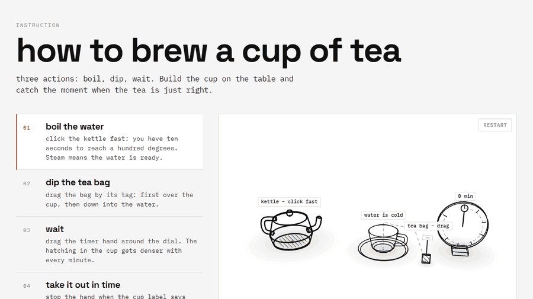

# how-to – an instruction you can touch

A skill for Claude Code. Ask "how do I do X" and get a single page: the order of steps on the left, a transparent ink drawing on the right. The reader performs each step on the drawing by hand – drags, clicks, clicks fast – and the steps tick themselves off.



**[Try the live demo →](https://mykhailus.github.io/how-to-skill/)**

## What you get

- **One html file.** No build step, no server. It opens in any browser and can be sent as is.
- **Objects drawn for the topic.** A kettle and a cup for tea, a card, a coin and a wallet for buying bitcoin, a knife and a whetstone for sharpening. Ink only, no colour: values are shown with shape and hatching.
- **Steps that check themselves.** Each step has a condition. Do the action on the drawing and the step gets a tick, the next one turns on.
- **Speed actions.** Where real life takes effort – boiling, pumping, whisking – you click fast against a ten-second clock.
- **A clear ending.** The result stays on the drawing, and a "done" card appears with a "start over" button.

The page is deliberately small: a title, 4–6 steps and the stage. No quizzes, sliders, glossaries or footnotes.

## Install

Copy the `how-to` folder into your Claude Code skills directory.

macOS / Linux:

```bash
git clone https://github.com/mykhailus/how-to-skill.git && cp -r how-to-skill/how-to ~/.claude/skills/
```

Windows (PowerShell):

```powershell
git clone https://github.com/mykhailus/how-to-skill.git; Copy-Item -Recurse how-to-skill\how-to "$env:USERPROFILE\.claude\skills\"
```

To use it in one project only, put the folder into `.claude/skills/` of that project.

## Use

```text
/how-to how to sharpen a knife
```

```text
/how-to how to set up two-factor authentication, for my parents
```

```text
/how-to how to read a food label --publish
```

The skill builds the page, opens it in your browser and answers with one link to the file. With `--publish` it puts the page out as a claude.ai artifact and answers with a link that opens anywhere.

Run `/how-to` with no topic to get a short hint with examples.

## What is inside

| file | purpose |
|---|---|
| `how-to/SKILL.md` | the instructions the model follows: find the action, draw the objects, write the steps |
| `how-to/template.html` | the engine and a teaching sample, "how to brew a cup of tea" |
| `how-to/to_artifact.py` | prepares a page for publishing as an artifact |
| `docs/` | the live demo (the same sample page) |

A page consists of three blocks. The model replaces `CONTENT` (text, steps, the `model(v)` function) and `SCENE` (the drawing), and leaves `ENGINE` untouched. The engine handles the ink rendering, handles, clicks, labels, step checks and the finish card.

## Requirements

- Claude Code with skills support.
- A browser with WebGL.
- An internet connection when the page opens: it loads [three.js](https://threejs.org/) from jsDelivr and two fonts from Google Fonts.
- Python 3 – only for `--publish`.

## Credits

The idea of an explanation you operate by hand comes from [Every Joule](https://everyjoule.com/).

## License

MIT
